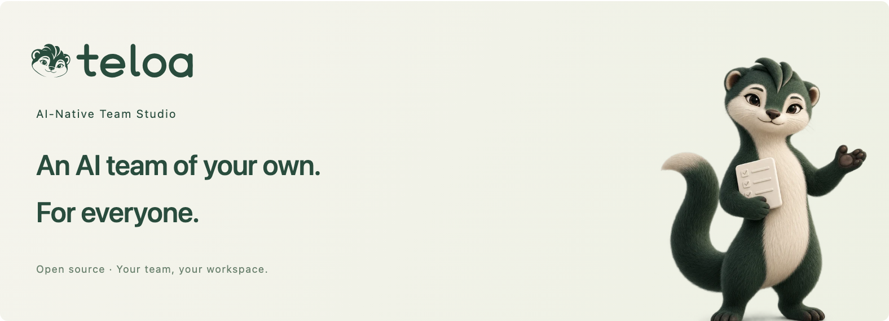

<p align="center">
  <a href="https://www.teloa.ai/en/"></a>
</p>

<p align="center">
  <a href="LICENSE"></a>
  <a href="https://www.npmjs.com/package/@teloa/cli"></a>
  <a href="https://hub.docker.com/r/teloa/teloa"></a>
  <a href="https://github.com/teloa-ai/teloa/actions/workflows/ci.yml"></a>
</p>

<p align="center">
  <a href="README.md">English</a> · <a href="README.zh-CN.md">简体中文</a>
</p>

<p align="center">
  <a href="https://www.teloa.ai/en/">Website</a> · <a href="https://docs.teloa.ai/en/">Docs</a> · <a href="https://market.teloa.ai/en/">Market</a> · <a href="https://www.teloa.ai/en/blog/">Blog</a> · <a href="https://security.teloa.ai/">AI Security</a> · <a href="https://github.com/teloa-ai/teloa">GitHub</a> · <a href="#quick-start">Quick start</a> · <a href="#product-editions">Editions</a> · <a href="CONTRIBUTING.md">Contributing</a>
</p>

# Teloa — An AI team of your own. For everyone.

Teloa is an **AI-Native Team Studio** for building, managing, and running teams of AI employees. Give each employee responsibilities, knowledge, skills, tools, memory, and permissions, then bring roles together to deliver results in one workspace. Start with a concrete task and build your team and working methods as you go.

This repository maintains **Teloa Community**: an [Apache-2.0](LICENSE) open-source edition for individuals and developers. Deploy it on your own computer and manage multiple AI employees in your personal Web workspace. **DeepSeek Harness (DSH)** supplies the current agent runtime.


*Community 0.2.4 actual interface with example tasks and an unsent draft. A fresh installation does not require demo data.*

[Get started with the new 0.2.4 features](https://docs.teloa.ai/en/start/whats-new)

## Why Teloa

- **AI employees with lasting roles.** Responsibilities, configuration, and role experience with sources carry forward between tasks.
- **Collaboration around deliverables.** Use groups, projects, tasks, and business records to follow work, handle approvals, and review results.
- **A workspace that follows your methods.** Combine knowledge, skills, tools, and automation. Configure business records and dashboards in natural language.
- **Working boundaries you control.** Self-host, choose model services, and manage data, access, and permissions. See [security and data](#security-and-data) for how remote services receive context.

[Read “From Agent to AI Organization: Why Teloa” →](https://www.teloa.ai/en/blog/why-teloa/)

[See the actual Community workspace →](https://www.teloa.ai/en/#screenshots)

## 30-second workspace tour

https://github.com/user-attachments/assets/24f31f10-8df6-46fc-b631-e54ca66ad3fe

Community 0.2.2 · Actual interface with sample data. [Watch with captions](https://www.teloa.ai/en/#film)

## Quick start

Bring your own model service and API key. Model usage is billed by your provider; the Community software license does not include inference credits.

**0.2.4** is the current Community release. Its native package is attached to the [GitHub Release](https://github.com/teloa-ai/teloa/releases/tag/v0.2.4) and has been verified on macOS arm64; [Docker Hub](https://hub.docker.com/r/teloa/teloa) provides the matching **Linux ARM64** image. [npm](https://www.npmjs.com/package/@teloa/cli) provides the same version. Source builds remain available below.

### What changes in this release

**A clearer workbench and more reliable first use:** your avatar opens My twin, with a separate Settings entry. Personal and employee editors preserve text drafts across navigation and refresh. The first configured BYOK provider can initialize an unavailable default; group routing follows the current default model. Task drafts are distinguished from saved tasks, with a form fallback and native approval before execution. Archive actions offer Undo, while high-impact actions use explicit confirmation.

**0.2.4 makes AI teams more dependable for continuous business work:** new events from connected business sources can start employee work one by one, and the business home shows which sources are actually connected. Group handoffs, quoted continuations and paused work now explain their status and can be retried or resumed in place. Delivery review recovers from more model slips with precise correction hints and no longer fails because of context compaction or a harmless refused call. Work budgets count model time in a rolling 24-hour window and explain why work stopped, and an explicit `teloa upgrade` resumes work that was paused only by the restart. AI-created employees and teams now import from the market, apps built in conversation reference real catalog connections with account setup in the apps directory, the library shows each employee's bundled materials and work outputs, and ordinary conversations load platform tools on demand, avoiding unused tool definitions.

**0.2.3 improves everyday collaboration:** conversations, groups, tasks and projects use one results sidebar, with a list-to-reading flow, preserved versions and drafts, and direct access to saved conversation results. Employee collaboration invitations and marketplace/detail layouts are more compact. Verified completed group replies no longer prevent the task directory from loading.

- **Projects and project memory:** dedicated project conversations, briefs, rules, relevant materials and sourced memories in model context, with review and withdrawal controls.
- **Knowledge and local models:** selected local Markdown files, indexes and cited retrieval; separately prepare embedding models or manage local chat models with Ollama. Retrieved excerpts may reach your chosen remote chat model.
- **Employees, teams and collaboration:** complete team resources, separate employee conversations, group-stream replies and topics, explicit mentions, and sourced employee experience through Auto Dream.
- **Tasks and deliverables:** Markdown task descriptions, contextual drafts, approvals, versioned results and feedback-driven revisions; reusable methods can become skills or paused plan drafts.
- **Voice and the companion:** local transcription, voice messages and calls, three speech providers, continuous playback and MiniMax bilingual voice lists with preview.
- **Execution and files:** temporary execution teams, Workflow/PTC/explicit Ralph, native Codex and Claude Code / Claude Agent integrations and file previews; optional browser/desktop tools remain separately configured and authorized.
- **Business and apps:** natural-language business drafts, approved record changes and accepted-result links, cleaner dashboard pages, and current marketplace/app terminology.

This overview covers the release’s capabilities and improvements; not all of them are newly introduced. Read the [full update and configuration boundaries](https://docs.teloa.ai/en/changelog/) before upgrading.

### Native installation from the GitHub Release

Use **Node.js 24.x** or **22.x from 22.19 onward**, **npm 11.x from 11.12.1 onward**, and a running local Docker engine for the dedicated PostgreSQL database. Install the exact version into a new command directory; no global installation or source build is required.

```sh
mkdir teloa-command
cd teloa-command
npm install --ignore-scripts https://github.com/teloa-ai/teloa/releases/download/v0.2.4/teloa-cli-0.2.4.tgz
./node_modules/.bin/teloa up
./node_modules/.bin/teloa doctor
./node_modules/.bin/teloa status
```

Teloa and DSH run natively on your computer. Startup opens the Web interface; configure your model in Settings. The default Web port is 3100. For a new installation, use `./node_modules/.bin/teloa up --port 3101` if it is occupied. The release also lists the package's SHA-256 checksum. To upgrade an existing installation, such as 0.2.0-alpha.7, keep its data and identity by installing the 0.2.4 package into a new command directory, then running `teloa stop` and `teloa upgrade --to 0.2.4` from that directory (pass the original `--home` for a custom installation). The upgrade creates a backup before switching. See the [installation and stop instructions](https://docs.teloa.ai/en/start/quickstart) and [backup and upgrades](https://docs.teloa.ai/en/deploy/backup). For the same version from the npm registry, use `npm install --ignore-scripts @teloa/cli@0.2.4`.

<details>
<summary><strong>Docker Hub with Compose (0.2.4)</strong></summary>

### Docker Hub with Compose

Install Docker with Compose and start the engine. The published image and the configuration below have been verified on **Linux ARM64**; **amd64 has not been verified**. Teloa, DSH and PostgreSQL run in containers, so host Node.js and pnpm are not required.

Download the versioned configuration into a new directory. It uses `teloa/teloa:0.2.4` for both initialization and the application, with persistent data volumes and a generated database password.

```sh
mkdir teloa-community
cd teloa-community
curl --fail --location https://docs.teloa.ai/downloads/0.2.4/compose.yaml --output compose.yaml
docker compose pull
docker compose up -d --no-build
docker compose ps
docker compose logs --tail=50 app
```

Wait for `db` and `app` to be healthy. Successful exit of the one-time `init` service is expected. Open the complete authentication link from the app log, using the configured local port (3100 by default). If the port is occupied, set `TELOA_PORT=3101` in this directory's `.env` before startup. Keep authentication links private. See [installation and lifecycle instructions](https://docs.teloa.ai/en/start/quickstart) and [backup and upgrades](https://docs.teloa.ai/en/deploy/backup).

Container tools run inside the container; mounting a folder does not give control of your host applications.

</details>

<details>
<summary><strong>Docker Compose from source</strong></summary>

### Docker Compose from source

Install Docker with Compose and start the engine. This route runs Teloa and PostgreSQL in containers; host Node.js and pnpm are not required.

```sh
git clone https://github.com/teloa-ai/teloa.git
cd teloa
docker compose up -d --build
docker compose ps
docker compose logs --tail=50 app
```

Wait for `db` and `app` to be healthy. `init` exits after initialization; that is expected. Open the **complete authentication link** printed in the app log. The default address uses `127.0.0.1:3100`. If that port is occupied, put `TELOA_PORT=3101` in a local `.env` before starting and use that port in the authentication link.

Database credentials are generated during initialization. Data persists in named volumes. To pause and resume:

```sh
docker compose stop
docker compose start
```

Container tools run inside the container. Mounting a folder does not give access to applications installed on your host. Use native execution when your work needs local programs.

</details>

<details>
<summary><strong>Native source installation</strong></summary>

### Native source installation

Use **Node.js 24.x** or **22.x from 22.19 onward**, **pnpm 11.7.0**, and a running local Docker engine for PostgreSQL. Teloa and DSH run on your computer, while the database runs in Docker.

The current main branch pins DSH **0.2.1-rc.2** and includes voice input by default. Published npm and Docker releases are updated separately; source features are not necessarily available in an older release.

```sh
git clone https://github.com/teloa-ai/teloa.git
cd teloa
pnpm install --frozen-lockfile
pnpm build
pnpm check:dsh
pnpm setup:database
pnpm setup:dsh
pnpm dev:dsh
```

Open the complete authentication URL printed at startup. On macOS or Linux, use `TELOA_DSH_PORT=3101 pnpm dev:dsh` to choose another Web port. Source-installation state stays under `.runtime/`; the default working directory is `.runtime/teloa/workspace`.

On first use, follow the voice prompt to prepare the local SenseVoice model and allow microphone access. Showing the button does not download models or start recording; cancelling setup preserves your draft. Transcription runs locally, and text you send is handled by your selected model service. If you disable voice input, later starts preserve that choice.

New installations also use local SenseVoice for call recognition. Open **Settings → Voice service → Download and prepare local recognition** to reach its model setup. Configure MiniMax speech credentials in that same settings page for speech output; saved recognition choices are preserved when speech output changes.

For local search, open **Library → Local → Open search settings**, enable local retrieval, and choose Qwen3 Embedding or Google EmbeddingGemma 2. The app includes their integrations; model weights download only after confirmation. EmbeddingGemma 2 requires Ollama installed and running on the Teloa host; the preparation page links to its installer and offers status refresh and retry.

See the [installation guide](https://docs.teloa.ai/en/start/quickstart) and [local development guide](https://docs.teloa.ai/en/develop/local-development) for deployment and troubleshooting. Back up your data before upgrades.

</details>

## Your first task

1. Open **Settings → Models**, configure a supported provider, and verify a simple conversation. Model credentials belong in Settings.
2. Create an **AI employee**. Define its responsibility, select reference material, and set its tool and approval boundaries.
3. Open its conversation and make a specific request, such as: “Summarize these files, cite the sources, and list what is still uncertain.”
4. For work that needs tracking, create or approve a task. Follow actual progress, handle requests in **Needs your attention**, and review the deliverable.
5. Organize related work in a business or project, then add a dashboard or schedule as needed.

## What you can do

| Capability | How it helps |
| --- | --- |
| **Conversations** | Work with text, files and images, use `@` references and `/` commands, and continue in the same context. |
| **Voice input and playback** | The conversation composer includes voice input by default. Prepare the local recognition model on first use, review the transcript in your draft, and send it when ready. Speech playback reads replies aloud with a provider and voice you choose and preview in Settings, using your own credentials. You can disable voice input in Settings. |
| **Context inspection** | Bundled dsh-context shows context composition, tokens, estimated cost and compaction records through conversation tabs, the right sidebar or `/context`. Provider billing remains authoritative. |
| **Messaging channels** | Built-in IM Gateway connects Feishu, Lark, Telegram and Slack after you configure and enable each channel in Settings. No separate plugin installation is required. |
| **AI employees and groups** | Define lasting roles with their own knowledge, skills and access. Bring employees together in a group for discussion and collaboration. |
| **Tasks and projects** | Assign a concrete goal, see the responsible employee and execution progress, and organize related work and deliverables around a project. |
| **Deliverables and revisions** | Deliverables keep their versions. Give feedback or revise a selected part in the original conversation; earlier versions stay readable. |
| **Businesses and dashboards** | Describe records, fields and views in natural language. Review and save the configuration, manage records, and build dashboards over the business data. |
| **Knowledge and skills** | Provide reference material and reusable working methods. Choose what each employee may use. |
| **Apps and the marketplace** | Add apps and skills under Apps and connect supported external tools through MCP. Add AI employee or AI team templates from the marketplace. |
| **Automation** | Schedule repeat work and follow its runs. Enable plans explicitly and keep the runtime online. |
| **Model configuration** | Configure model services supported by the runtime with your own credentials. Employee model settings and permissions remain separate. |

## How the pieces work together

A **business** organizes records, people and resources. An **AI employee** owns a role; a **skill** supplies a method; **knowledge** provides evidence; a **connector** gives access to a system. A **task** tracks an assignment, a **deliverable** preserves its output, and a **dashboard** summarizes the business records.


*0.2.4 interface with 8 fictional sample records. A business keeps records, dashboards, AI employees, groups and projects together; Start work begins work from here.*

For example, in **security operations (SOC)**:

1. Describe an alert-tracking business and review its record fields and pages.
2. Add local records, import a supported table, or configure an authorized data connection.
3. Give an analyst employee relevant procedures, evidence and tools, then assign an alert investigation.
4. Follow the task, inspect the evidence and review the deliverable linked to that alert.
5. Use a dashboard to summarize alert status, severity and trends.

Adding a team template does not automatically connect accounts, authorize employees or start scheduled work. Those choices stay with you.

[](https://docs.teloa.ai/assets/screenshots/en/business-dashboard-024.22f992c8cf57.png)

*Dashboards work the same way across businesses. This example uses a marketplace content operations dashboard with 8 fictional sample records in the 0.2.4 interface; it is not live data. Detail preview; click to view the complete screenshot.*

SOC is the first end-to-end business scenario. Customer delivery, content operations, retail, software development, education, store services and other security workflows are **future scenario examples**, rather than completed integrations. See [industry examples](https://docs.teloa.ai/en/tutorials/industry-examples) and the [SOC walkthrough](https://docs.teloa.ai/en/tutorials/soc-triage).

<a id="data-permissions-and-product-editions"></a>

## Product editions

Teloa's three editions share the same product core and serve different working needs. This repository maintains the open-source Community edition.

| Edition | Who it is for and how it is used |
| --- | --- |
| Community | An open-source edition for individuals and developers. Deploy and configure your own workspace with AI employees, collaboration, tasks, automation and skills. |
| Pro | A native Mac application for personal and professional work. Get started with local task execution and access to your files and apps, then create, follow and continue work from your phone. |
| Enterprise | For businesses and organizations, deployed in the company cloud or internal network. Manage members, shared AI employees, permissions and audit, and connect internal data, systems and business workflows. |

## Call employees from your business system

Create a scoped key under **Settings > Employee integrations** to call a fixed employee version through the **HTTP API, TypeScript/JavaScript SDK or MCP Server**. Requests use persistent work IDs and idempotency keys; results have fixed versions and checksums. Signed CloudEvents callbacks support retries and delivery records.

The API uses the same employee permissions, BYOK and Task/Run pipeline as the workbench. Execution, tool approval and business acceptance remain separate. See the [SDK and integration contract](packages/sdk/README.md) or [integration guide](https://docs.teloa.ai/en/develop/employee-api).

## Documentation

| What you want to do | Start here |
| --- | --- |
| Install and complete your first task | [Installation](https://docs.teloa.ai/en/start/quickstart) · [First task](https://docs.teloa.ai/en/start/first-task) |
| Build an AI team | [Employees](https://docs.teloa.ai/en/guides/colleagues) · [Groups](https://docs.teloa.ai/en/guides/groups) |
| Configure businesses and extend capabilities | [Businesses and dashboards](https://docs.teloa.ai/en/guides/business) · [Market](https://docs.teloa.ai/en/guides/market) |
| Explore industry workflows | [Industry examples](https://docs.teloa.ai/en/tutorials/industry-examples) · [SOC walkthrough](https://docs.teloa.ai/en/tutorials/soc-triage) |
| Maintain and upgrade an installation | [Backup and upgrades](https://docs.teloa.ai/en/deploy/backup) · [Security policy](SECURITY.md) |
| Explore agent security and assess your platform | [Teloa AI Security](https://security.teloa.ai/) · [Baseline self-assessment](https://security.teloa.ai/agent-baseline-assessor/?lang=en) |
| Develop and contribute | [Local development](https://docs.teloa.ai/en/develop/local-development) · [Contributing](CONTRIBUTING.md) |

## Architecture and development

ESP32 firmware is maintained in [teloa-ai/teloa-firmware](https://github.com/teloa-ai/teloa-firmware).

| Product layer | Responsibility |
| --- | --- |
| **AI Team** | Employees, collaboration, businesses, projects, tasks and automation. |
| **Agent Studio** | Each employee's responsibilities, knowledge, skills, tools and permissions. |
| **Agent Harness** | Models, execution environments, tools, sandboxing, approvals and runtime events. DSH supplies the current runtime. |

<details>
<summary>Source layout and validation commands</summary>

Business services, runtime adaptation and the UI are organized separately:

| Directory | Purpose |
| --- | --- |
| `packages/contract` | Shared types and protocols. |
| `packages/backend` | PostgreSQL-backed business services. |
| `packages/harness-dsh` | DSH integration, task execution and authorization checks. |
| `packages/client/`, `packages/bundle` | Web workspace, shared UI and runtime composition. |
| `packages/cli`, `packages/native-*` | Installation lifecycle and native tool integrations. |
| `packages/mcp-reference`, `packages/im-gateway`, `packages/local-embedding` | Reference access, messaging integration and local retrieval. |
| `config/`, `scripts/` | Pinned dependency baseline, preparation and startup. |
| `tests/`, `examples/industry/` | Regression tests and synthetic business-format examples. |

Before submitting a change:

```sh
pnpm build
pnpm check:client
pnpm check:dsh
NODE_OPTIONS=--max-old-space-size=4096 pnpm typecheck
pnpm test:repo
pnpm test:contract
pnpm test:bindings
```

Run relevant backend or runtime tests for behavior changes. These may require Docker and isolated databases. Keep runtime data and credentials out of commits. See [CONTRIBUTING.md](CONTRIBUTING.md) for the contribution process and DCO requirements.

</details>

## Security and data

Application data is stored on the machine running Teloa. Remote models and authorized external tools receive the task context they need. Self-hosting does not make every model call offline. See [SECURITY.md](SECURITY.md) for the permission model and known limitations.

All editions use your own model service and API keys; model usage is billed separately. External integrations require compatible services and credentials. Stopping a conversation does not guarantee immediate cancellation of every external request.

[Teloa AI Security](https://security.teloa.ai/) turns security design questions from Teloa development into open research and tools. Its [Enterprise Agent Identity and Authorization Security Baseline](https://github.com/teloa-ai/agent-baseline-assessor) provides **240 requirements across three levels (L1–L3)**, with **seven language versions** and an [online self-assessment tool](https://security.teloa.ai/agent-baseline-assessor/?lang=en). The baseline defines assessment goals; it is not a certification or a claim that Teloa implements every requirement. Assess a specific product version and deployment against evidence.

Follow [SECURITY.md](SECURITY.md) for security reports: use a sanitized public [Issue](https://github.com/teloa-ai/teloa/issues) by default; for potentially high-impact issues, we recommend contacting [security@teloa.ai](mailto:security@teloa.ai) privately first. Keep credentials, private data and unpublished exploit details out of public reports. Ordinary bugs and proposals also go to GitHub Issues.

## Community and license


Meet Teloa, our squirrel companion. Find more community artwork in the [brand kit](https://www.teloa.ai/en/brand-kit/) and see the [image usage notes](assets/brand/README.md).

- Bugs and proposals: [GitHub Issues](https://github.com/teloa-ai/teloa/issues).
- Contributions: [guide](CONTRIBUTING.md) and [DCO](DCO.md).
- Product support: [support@teloa.ai](mailto:support@teloa.ai).
- Business inquiries: [hi@teloa.ai](mailto:hi@teloa.ai).
- Serious security issues: [security@teloa.ai](mailto:security@teloa.ai), following [SECURITY.md](SECURITY.md). General reports can use Issues; keep sensitive details private.

Teloa Community is licensed under **[Apache-2.0](LICENSE)**. Third-party components retain their own licenses; see [NOTICE](NOTICE) and [THIRD_PARTY_NOTICES.md](THIRD_PARTY_NOTICES.md). The name and branding are covered by the [trademark policy](TRADEMARK.md).
